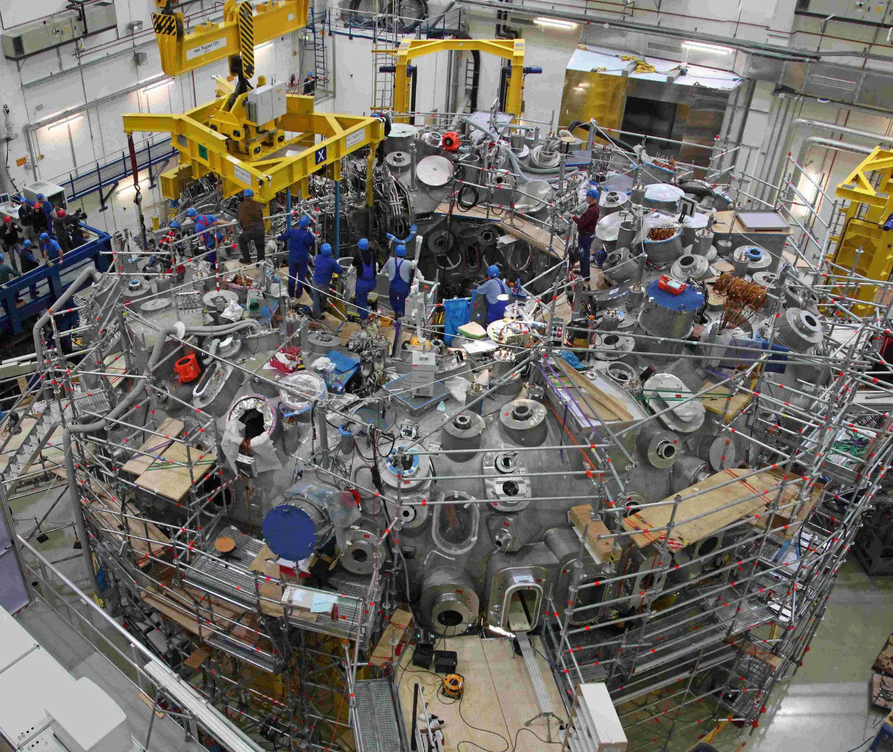

# stellarator_configprocessor

[Nederlands](#nederlands) | [English](#english)

---

<a id="nederlands"></a>

# Nederlands

Een open preprocessor voor het stellaratormodel van
[PROCESS](https://github.com/ukaea/process), de systeemcode voor
fusiecentrales.

PROCESS kan elke modulaire stellarator modelleren als het een
configuratiebestand (`stella_conf.json`) krijgt met vooraf berekende
"effectieve parameters" voor dat ontwerp. Het programma dat de documentatie
van PROCESS noemt om dit bestand te maken, pre-sPROCESS, is niet openbaar
beschikbaar. Dit project berekent hetzelfde bestand uit twee gangbare
invoerbestanden:

- een plasma-evenwicht: VMEC-`wout`-bestand (NetCDF);
- een spoelenset: MAKEGRID-bestand `coils.*` met filamentkrommen en stromen.

De methode volgt Lion et al., *Nuclear Fusion* 61 (2021) 126021.

## Status

Ontwikkelversie, nog niet uitgebracht. Geschreven voor PROCESS 3.4.2.

- Alle 35 waarden die PROCESS leest, worden geschreven. Twee daarvan
  (`epseff`, `neutron_peakfactor`) worden doorgegeven vanaf de opdrachtregel
  en niet berekend.
- PROCESS 3.4.2 accepteert het gegenereerde bestand met `istell = 6`.
- Voor de W7-X-spoelen zoals gebouwd komen de berekende waarden binnen enkele
  procenten overeen met de ingebouwde W7-X-set van PROCESS. De verschillen
  worden verklaard in [docs/w7x_comparison.md](docs/w7x_comparison.md).

## Installatie

Python 3.10 of nieuwer. Afhankelijkheden: NumPy en netCDF4.

```
pip install -e .
```

## Gebruik

```
stellarator-configprocessor wout_mydesign.nc coils.mydesign \
    --wp-radial 0.6 --wp-toroidal 0.5 \
    --epseff 0.015 --neutron-peakfactor 1.6 \
    --process-input myrun.IN.DAT --report myrun_report.txt
```

Dit schrijft `myrun.stella_conf.json` naast `myrun.IN.DAT`, de plek waar
PROCESS het zoekt, en een rapport met elke waarde, de eenheid en de manier
waarop ze is verkregen.

De vier getoonde instellingen hebben geen standaardwaarde: de resultaten
hangen af van de afmetingen van het wikkelpakket, en de laatste twee kan dit
programma niet berekenen.

Zie [docs/user_guide.md](docs/user_guide.md) voor alle opties en een
uitgewerkt voorbeeld van bestanden tot een PROCESS-run.

## Documentatie

De documenten zelf zijn in het Engels.

| Document | Inhoud |
|---|---|
| [docs/user_guide.md](docs/user_guide.md) | Opties, invoer, uitgewerkt W7-X-voorbeeld, Python-interface, gebruiksbeperkingen |
| [docs/schema.md](docs/schema.md) | Elke sleutel van `stella_conf.json`: eenheid, hoe PROCESS haar gebruikt, hoe ze wordt berekend; referentiewaarden |
| [docs/w7x_comparison.md](docs/w7x_comparison.md) | PROCESS-run met het gegenereerde W7-X-bestand tegenover de ingebouwde W7-X-set |
| [docs/hsx_check.md](docs/hsx_check.md) | Tweede machine (HSX): controle op algemene toepasbaarheid en wat die aan het licht bracht |

## Verificatie

```
pip install -e ".[test]"
python scripts/fetch_reference_data.py    # optioneel: openbare W7-X- en HSX-bestanden
pytest
```

| Grootheid | Gecontroleerd tegen | Overeenkomst |
|---|---|---|
| Plasmavolume, -oppervlak, stralen | cirkelvormige torus (analytisch); de waarden van VMEC zelf voor W7-X | 1e-12; 1e-10 |
| Veld van een filament | cirkelvormige lus en rechte draad (analytisch) | 1e-4 |
| Veld op de as van de W7-X-spoelen | het vacuümevenwicht van W7-X | 5e-6 |
| Veld binnen de geleider | rechte rechthoekige staaf (gesloten uitdrukking) | 2%, beperkt door de kromming van de lus |
| Zelfinductie | formule voor een cirkelvormige lus; volume-integraal van B^2 | 0,2%; 2% |
| Wederzijdse inductie | coaxiale lussen (elliptische integralen) | 1e-4 |
| Hoepelkracht | formule voor een cirkelvormige lus | 2% |
| Netto kracht op een spoel | afgeleide van de magnetische energie (virtuele arbeid) | 0,6% |
| Veld op de as, spoellengtes (W7-X) | SIMSOPT, in CI | 1e-3; 1e-4 |
| Volledig W7-X-resultaat | ingebouwde W7X-50-waarden van PROCESS | zie docs/w7x_comparison.md |
| Volledig HSX-resultaat | consistentie met het evenwicht; plausibiliteit | zie docs/hsx_check.md |

Tests die de W7-X- of HSX-bestanden nodig hebben, worden overgeslagen als die
bestanden ontbreken. De kruiscontrole met SIMSOPT wordt overgeslagen als
SIMSOPT niet is geïnstalleerd.

## Bekende problemen

### Nog niet geverifieerd

- **Geen onafhankelijke controle van piekveld, energie en krachten op een
  echte machine.** Deze berusten op analytische testgevallen en op
  overeenkomst met de ingebouwde W7-X-waarden van PROCESS, waarvan sommige
  zijn afgerond of plaatshouders zijn. De kruiscontrole met SIMSOPT dekt
  alleen het filamentveld en de spoellengtes.
- **Twee onverklaarde verschillen met de ingebouwde W7-X-waarden.** `a2` ligt
  25% boven de ingebouwde waarde en `max_lateral_force_density` 10% erboven.
  De fit reproduceert de velden die dit programma berekent tot op 0,06%;
  welke kant gelijk heeft, staat niet vast.
- **Drie definities zijn beredeneerde aannames.** Voor `coil_rminor`,
  `coilsurface` en `max_portsize_width` is geen formule gepubliceerd. De
  gebruikte definities zijn gekozen omdat ze passen bij de beschikbare
  referentiewaarden; alleen de auteurs van het oorspronkelijke programma
  kunnen ze bevestigen. Zie [docs/schema.md](docs/schema.md).
- **Geen volledig geoptimaliseerd PROCESS-ontwerp.** PROCESS leest en
  evalueert de gegenereerde bestanden. Een optimalisatie op reactorschaal
  vond geen haalbare centrale voor W7-X, noch met de gegenereerde, noch met
  de ingebouwde configuratie, en voor een andere machine is geen
  optimalisatie uitgevoerd.
- **Paden zonder test op echte gegevens.** Spoelensets met ongelijke stromen,
  evenwichten zonder stellaratorsymmetrie en evenwichten met eindige druk
  worden door de code afgehandeld, maar zijn alleen op synthetische gevallen
  of helemaal niet uitgevoerd.
- **De nauwkeurigheid voor HSX is onbekend.** De tweede machine laat zien dat
  het programma algemeen toepasbaar is en plausibele resultaten geeft; er
  zijn geen referentiewaarden voor.

### Niet gedaan

- **`epseff` en `neutron_peakfactor` worden niet berekend.** Het zijn
  verplichte invoerwaarden die worden doorgegeven aan het bestand. Zolang ze
  niet worden berekend, vervangt het programma pre-sPROCESS niet volledig.
- **PROCESS maakt geen deel uit van de geautomatiseerde tests.** Het schema
  is alleen via de documenten aan PROCESS 3.4.2 gekoppeld, zodat een
  schemawijziging in PROCESS niet automatisch wordt opgemerkt.

### Bewuste keuzes

- **Alleen modulaire spoelen.** Elke spoel moet poloïdaal om het plasma
  sluiten.
- **Eén spoelstroom.** PROCESS schaalt één stroom, dus spoelensets met
  ongelijke stromen worden teruggebracht tot hun gemiddelde absolute stroom,
  met een waarschuwing. Spoelen zonder stroom worden genegeerd.
- **Invoerformaten.** Alleen VMEC-`wout` en MAKEGRID.

### In PROCESS zelf

Gevonden bij het lezen en uitvoeren van PROCESS 3.4.2; details in
[docs/schema.md](docs/schema.md), sectie 6.

- De documentatie verwisselt `istell = 4` en `istell = 5`: in de code is 4
  de W7-X-set met 30 spoelen en 5 de set met 50 spoelen.
- Een sleutel die in het configuratiebestand ontbreekt, wordt stilzwijgend
  als nul gelezen.
- De centrerende krachten worden geschaald met de verhouding van de
  spoellengtes omgekeerd ten opzichte van vgl. (43) van Lion et al. 2021.
- Op Windows zelf mislukt een run zonder de noodoplossingen in
  `scripts/run_process_windows.py`.

## Licentie

MIT. Zie [LICENSE](LICENSE).

---

<a id="english"></a>

# English

An open pre-processor for the stellarator model of the
[PROCESS](https://github.com/ukaea/process) fusion power plant systems code.

PROCESS can model any modular stellarator if it is given a configuration file
(`stella_conf.json`) of pre-calculated "effective parameters" for that design.
The tool that PROCESS's documentation names for producing this file,
pre-sPROCESS, is not publicly available. This project computes the same file
from two standard inputs:

- a plasma equilibrium: VMEC `wout` file (NetCDF);
- a coil set: MAKEGRID `coils.*` file with filament curves and currents.

The method follows Lion et al., *Nuclear Fusion* 61 (2021) 126021.

## Status

Development version, not yet released. Written against PROCESS 3.4.2.

- All 35 values PROCESS reads are written. Two of them (`epseff`,
  `neutron_peakfactor`) are passed through from the command line, not
  computed.
- PROCESS 3.4.2 accepts the generated file with `istell = 6`.
- For the as-built W7-X coils, the computed values agree with PROCESS's
  built-in W7-X set to within a few percent, and the differences are
  explained in [docs/w7x_comparison.md](docs/w7x_comparison.md).

## Install

Python 3.10 or newer. Dependencies: NumPy and netCDF4.

```
pip install -e .
```

## Use

```
stellarator-configprocessor wout_mydesign.nc coils.mydesign \
    --wp-radial 0.6 --wp-toroidal 0.5 \
    --epseff 0.015 --neutron-peakfactor 1.6 \
    --process-input myrun.IN.DAT --report myrun_report.txt
```

This writes `myrun.stella_conf.json` next to `myrun.IN.DAT`, which is where
PROCESS looks for it, and a report listing every value, its unit and how it
was obtained.

The four settings shown have no defaults: the results depend on the winding
pack dimensions, and the last two cannot be computed by this tool.

See [docs/user_guide.md](docs/user_guide.md) for all options and a worked
example from files to a PROCESS run.

## Documentation

| Document | Content |
|---|---|
| [docs/user_guide.md](docs/user_guide.md) | Options, inputs, worked W7-X example, Python interface, usage limits |
| [docs/schema.md](docs/schema.md) | Every key of `stella_conf.json`: unit, how PROCESS uses it, how it is computed; reference values |
| [docs/w7x_comparison.md](docs/w7x_comparison.md) | PROCESS run with the generated W7-X file against the built-in W7-X set |
| [docs/hsx_check.md](docs/hsx_check.md) | Second machine (HSX): generality check and what it exposed |

## Verification

```
pip install -e ".[test]"
python scripts/fetch_reference_data.py    # optional: public W7-X and HSX files
pytest
```

| Quantity | Checked against | Agreement |
|---|---|---|
| Plasma volume, area, radii | circular torus (analytic); VMEC's own values for W7-X | 1e-12; 1e-10 |
| Field of a filament | circular loop and straight wire (analytic) | 1e-4 |
| Field on axis of W7-X coils | the W7-X vacuum equilibrium | 5e-6 |
| Field inside the conductor | straight rectangular bar (closed form) | 2%, limited by loop curvature |
| Self-inductance | circular loop formula; volume integral of B^2 | 0.2%; 2% |
| Mutual inductance | coaxial loops (elliptic integrals) | 1e-4 |
| Hoop force | circular loop formula | 2% |
| Net coil force | derivative of the magnetic energy (virtual work) | 0.6% |
| Field on axis, coil lengths (W7-X) | SIMSOPT, in CI | 1e-3; 1e-4 |
| Full W7-X result | PROCESS built-in W7X-50 values | see docs/w7x_comparison.md |
| Full HSX result | consistency with its equilibrium; plausibility | see docs/hsx_check.md |

Tests that need the W7-X or HSX files are skipped when the files are absent. The
SIMSOPT cross-check is skipped when SIMSOPT is not installed.

## Known issues

### Not yet verified

- **No independent check of peak field, energy and forces on a real machine.**
  These rest on analytic test cases and on agreement with PROCESS's built-in
  W7-X values, some of which are rounded or placeholders. The SIMSOPT
  cross-check covers only the filament field and the coil lengths.
- **Two unexplained differences from the built-in W7-X values.** `a2` is 25%
  above the built-in value and `max_lateral_force_density` 10% above. The fit
  reproduces the fields this tool computes to 0.06%; which side is right is
  not established.
- **Three definitions are informed guesses.** `coil_rminor`, `coilsurface`
  and `max_portsize_width` have no published formula. The definitions used
  were chosen to match the available reference values; only the authors of
  the original tool can confirm them. See [docs/schema.md](docs/schema.md).
- **No complete optimised PROCESS design.** PROCESS reads and evaluates the
  generated files. A reactor-scale optimisation found no feasible plant for
  W7-X, with either the generated or the built-in configuration, and no
  optimisation has been run for another machine.
- **Paths without a real-data test.** Coil sets with unequal currents,
  equilibria without stellarator symmetry and finite-pressure equilibria are
  handled in the code but have only been run on synthetic cases or not at all.
- **Accuracy on HSX is unknown.** The second machine shows the tool is
  general and its results plausible; there are no reference values for it.

### Not done

- **`epseff` and `neutron_peakfactor` are not computed.** They are required
  inputs, passed through to the file. Until they are computed, the tool does
  not fully replace pre-sPROCESS.
- **PROCESS is not part of the automated tests.** The schema is tied to
  PROCESS 3.4.2 by the documents only, so a schema change upstream would not
  be caught automatically.

### By design

- **Modular coils only.** Every coil must close poloidally around the plasma.
- **One coil current.** PROCESS scales a single current, so coil sets with
  unequal currents are reduced to their mean absolute current, with a
  warning. Coils with zero current are ignored.
- **Input formats.** VMEC `wout` and MAKEGRID only.

### In PROCESS itself

Found while reading and running PROCESS 3.4.2; details in
[docs/schema.md](docs/schema.md), section 6.

- The documentation swaps `istell = 4` and `istell = 5`: in the code, 4 is
  the 30-coil W7-X set and 5 the 50-coil set.
- A key missing from the configuration file is silently read as zero.
- The centering forces are scaled with the coil-length ratio inverted
  relative to eq. (43) of Lion et al. 2021.
- On native Windows a run fails without the workarounds in
  `scripts/run_process_windows.py`.

## Licence

MIT. See [LICENSE](LICENSE).
